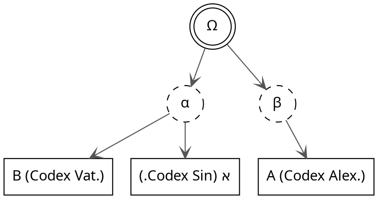
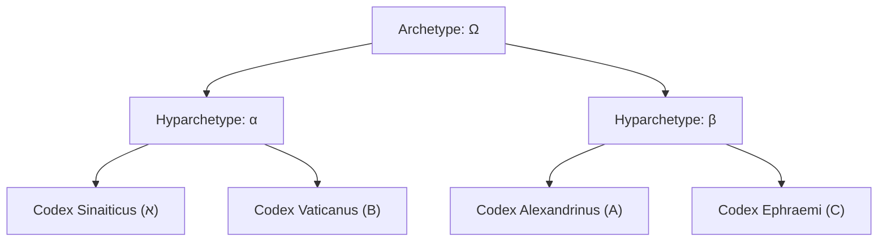

# Lesson 13.1 — Constructing the Stemma Codicum and Formulating Editorial Principles

*RELS 398 / ENGL 398 · Topic 13: Publication · Meeting #34 (Tue Dec 1)*

***Studio and publication assembly week (no three-step cycle).** Today you construct the stemma codicum (graphical genealogy, shared errors, and eliminatio codicum descriptorum) and formulate the comprehensive Editorial Introduction and Principles in TEI `<editorialDecl>` for your final edition portfolio.*

---

## **01 Content**

**The Architecture of the Final Digital Edition Portfolio**

Over the preceding twelve weeks, you have methodically constructed the individual components of a comprehensive digital scholarly edition. You began in Topic 1 with repository initialization and Unicode Greek encoding; catalogued codicological metadata and linked data identifiers in Topic 2; bound high-resolution IIIF facsimiles in Topic 3; transcribed diplomatic ground truth and evaluated HTR error rates in Topics 4 and 5; formulated orthographic normalization rules in Topic 6; executed algorithmic collation in Topic 7; constructed a multi-witness critical apparatus in Topic 8; applied morphosyntactic lemmatization in Topic 9; synthesized translation alignments in Topic 11; and authored categorized scholarly commentary in Topic 12 (Sahle, 2016; Pierazzo, 2016).

Now, in Topic 13, you enter the final studio and publication phase. A digital scholarly edition is not merely a disconnected folder of XML files, scripts, and image links; it is a unified, publication-grade scholarly system. The goal of this week is to integrate these ten progressive layers into an authoritative, multi-modal critical edition capable of serving both specialized philologists and students across web, interactive HTML, and print media (Driscoll & Pierazzo, 2016).

The editorial studio operates without the weekly three-step cycle. Instead, each day focuses on a vital dimension of edition synthesis: today you construct the genealogical *stemma codicum* and author the comprehensive editorial introduction; tomorrow you configure the TEI Processing Model and ODD transformation pipelines; and on Friday you compile the final multi-modal deliverables (Fischer, 2020).

| Edition Layer | Methodological Component | Core TEI & Technical Standards |
| --- | --- | --- |
| **Layer 01** | Codicological Metadata & Provenance | `<teiHeader>`, `<msDesc>`, CTS URNs |
| **Layer 02** | Deep-Zoom Digital Facsimile Binding | IIIF Presentation API 3.0, Canvas Coordinates |
| **Layer 03** | Character-Accurate Diplomatic Ground Truth | UTF-8 Polytonic Greek, Transkribus HTR |
| **Layer 04** | Orthographic Regularization Policy | TEI `<choice>`, `<orig>`, `<reg>`, Regular Expressions |
| **Layer 05** | Algorithmic Multi-Witness Collation | CollateX Alignment Matrix, Variant Graph |
| **Layer 06** | Multi-Tier Critical Apparatus | TEI `<app>`, `<lem>`, `<rdg>`, Parallel Segmentation |
| **Layer 07** | Morphological Parsing & Lemmatization | CLTK Greek Pipeline, TreeTagger, `<w lemma="" pos="">` |
| **Layer 08** | Interlinear Glossing & Critical Translation | Leipzig Glossing Rules, TEI `<linkGrp>`, Alignment |
| **Layer 09** | Categorized Scholarly Commentary | TEI `<standOff>`, `<interpGrp>`, W3C Web Annotation |
| **Layer 10** | Stemmatological Introduction & Multi-Modal Output | ODD Processing Model, CSS Paged Media, PDF |

**Vocabulary.** *Digital Scholarly Edition (DSE)* — an edition guided by the digital paradigm that cannot be rendered in print without critical loss of content or functionality. *Portfolio synthesis* — the integration of multi-layered transcriptions, collations, and commentaries into a unified release. *Editorial studio* — a dedicated workshop environment where complex scholarly assets are assembled and peer-reviewed.

**Takeaway:** The final digital edition portfolio integrates ten distinct philological and computational layers into a unified, publication-grade digital scholarly edition.

---

## **02 Content**

**The Epistemology of the Editorial Introduction**

In both print and digital traditions, the **Editorial Introduction** represents the intellectual anchor of the entire edition. It is the public space where the editor establishes authority, defines historical context, documents surviving witnesses, justifies text-critical emendations, and articulates explicit encoding policies (Driscoll & Pierazzo, 2016; Fischer, 2020).

Without a rigorous introduction, a critical edition is epistemologically opaque. A reader encountering an apparatus entry or a normalized spelling cannot determine whether a specific reading reflects an authorial revision, a scribal corruption, an editorial conjecture, or a standardized typographical convention. In traditional print scholarship, this rationale was presented in extensive Latin or vernacular prefaces (*praefationes*). In digital scholarship, the introduction is twofold: it exists as narrative scholarly prose for human readers and as structured, machine-actionable metadata within the `<teiHeader>` (Buzzoni, 2016; TEI Consortium, 2026).

| Introduction Dimension | Print Edition Expression | Digital Edition Implementation |
| --- | --- | --- |
| **Witness Documentation** | Narrative manuscript catalogue in preface | `<sourceDesc>` with structured `<msDesc>` and IIIF links |
| **Genealogical Rationale** | Static 2D stemma diagram | Graph-based stemma, `<listWit>`, and CollateX variant matrix |
| **Editorial Rules** | General prose statements on spelling/apparatus | Machine-actionable `<editorialDecl>` with explicit sub-elements |
| **Linguistic Scope** | Footnotes explaining difficult grammatical forms | Inline `<w>` tags linked to digital lexica and treebanks |
| **Licensing & Provenance** | Copyright page on verso of title leaf | `<publicationStmt>` with CC BY / CC0 and `<revisionDesc>` |

By publishing an exhaustive editorial introduction, you transform your edition from a subjective collection of personal readings into an open, reproducible, and verifiable contribution to historical philology (Sahle, 2016; Barzaghi et al., 2025).

**Vocabulary.** *Praefatio* — the formal Latin preface of a classical critical edition detailing witnesses and editorial rules. *Epistemological opacity* — the condition wherein a scholar's editorial choices cannot be verified due to missing methodological documentation. *Machine-actionable metadata* — data structured in standardized formats (such as XML) that can be queried and processed automatically by software.

**Takeaway:** The editorial introduction provides the essential methodological rationale that makes editorial choices transparent, accountable, and scientifically reproducible.

---

## **03 Content**

**The Classical Stemmatological Method: History and Principles**

Textual criticism emerged as a formal scientific discipline during the nineteenth century, driven by the desire to reconstruct ancient and medieval texts that survived only in corrupt, late handwritten copies. The foundational figure in this methodological revolution was the German philologist Karl Lachmann (1793–1851), whose editions of the New Testament (1831) and Lucretius (1850) established what became known as the **Lachmannian method** or **classical stemmatology** (Maas, 1958; Andrews, 2020).

Before Lachmann, editors practiced what was known as *eclecticism* or relied uncritically on the *textus receptus* (the "received text" established by early Renaissance printers). Editors would select whichever reading sounded most elegant or plausible (*usus scribendi*), often without understanding the historical relationships among the surviving manuscripts. Lachmann demonstrated that editorial choices must be grounded in an objective, genealogical history of the text's transmission (Maas, 1958).

Stemmatology operates on the premise that manuscript transmission is a historical process of copying. Every time a scribe copies a manuscript, they introduce errors: misread letters, skipped lines (*lacunae*), duplicate words (*dittographies*), and misspellings. Because these errors are passed down to subsequent copies, manuscripts that share distinctive errors must belong to the same genealogical family (Andrews, 2020; Guillaumin, 2020).

| Stemma Node | Node Category | Diagnostic Criterion | Descendants |
| --- | --- | --- | --- |
| **$\Omega$ (Archetype)** | Root Archetype | Lost common ancestor of all surviving manuscripts | Branch $\alpha$, Branch $\beta$ |
| **$\alpha$ (Hyparchetype)** | Intermediate Ancestor | Defined by Shared Conjunctive Error 1 | Witness A, Witness B |
| **$\beta$ (Hyparchetype)** | Intermediate Ancestor | Defined by Shared Conjunctive Error 2 | Witness C, Witness D |
| **Witnesses A & B** | Extant Manuscripts | Inherit Error 1; independent siblings | Modern collated witnesses |
| **Witnesses C & D** | Extant Manuscripts | Inherit Error 2; independent siblings | Modern collated witnesses |

**Vocabulary.** *Stemmatology* — the scientific study of the genealogical relationships among surviving manuscript witnesses. *Textus receptus* — the historically received or dominant print text of a work prior to modern critical editing. *Archetype ($\Omega$)* — the lost common ancestor of all surviving manuscript witnesses of a text.

**Takeaway:** Classical stemmatology replaces subjective editorial taste with an objective genealogical analysis of manuscript copying errors.

---

## **04 Content**

**The Three Steps of Stemmatology: Recensio, Examinatio, Emendatio**

In his classic manual *Textual Criticism* (*Textkritik*), Paul Maas formalized classical stemmatology into three distinct, sequential operations: *recensio*, *examinatio*, and *emendatio* (Maas, 1958).

The three steps must be performed in strict sequence to avoid circular reasoning:

| Step | Latin Term | Primary Objective | Philological Operation |
| --- | --- | --- | --- |
| **Step 1** | *Recensio* | Survey and Collation | Assemble all extant witnesses, collate variants, and construct the stemma codicum |
| **Step 2** | *Examinatio* | Critical Examination | Evaluate variants at each node using stemmatic weighting to determine the ancestral text |
| **Step 3** | *Emendatio* | Textual Emendation | Restore the authorial text through conjectural emendation where the archetype is corrupt |

During *recensio*, the editor remains strictly descriptive. You do not judge whether a reading is aesthetically pleasing; you systematically record every textual difference across all witnesses (Topic 7). From this collation data, you construct the *stemma codicum*—a genealogical tree illustrating how manuscripts descend from common lost ancestors (Maas, 1958; Andrews, 2020).

During *examinatio*, the editor uses the stemma to reconstruct the text of the archetype ($\Omega$). If the stemma splits into two independent branches ($\alpha$ and $\beta$), and Branch $\alpha$ agrees with Branch $\beta$ against a single divergent manuscript, the reading attested by both branches is mathematically proven to be the reading of the archetype. Editorial subjective judgment is only required when the independent branches disagree, requiring the editor to evaluate intrinsic probability (*usus scribendi*) and transcriptional probability (*lectio difficilior*) (Maas, 1958; Fischer, 2020).

Finally, if the reconstructed archetype contains an obvious nonsensical error or historical impossibility, the editor performs *emendatio* (*divinatio*), proposing a conjectural correction that restores what the original author must have written before the archetype was copied (Maas, 1958; Lazzerini & Di Franco, 2026).

**Vocabulary.** *Recensio* — the exhaustive survey, collation, and genealogical classification of all surviving witnesses. *Examinatio* — the critical weighing of variant readings based on stemmatic authority and intrinsic probability. *Emendatio* — the conjectural restoration of an authorial reading corrupted in the archetype.

**Takeaway:** Classical editing proceeds strictly from objective genealogical survey (*recensio*) to critical evaluation (*examinatio*) and final conjectural correction (*emendatio*).

---

## **05 Content**

**The Diagnostic Logic of Shared Errors (Errores Conjunctivi)**

The entire edifice of stemmatic reconstruction rests upon a fundamental logical principle: **genealogical relationships are proven exclusively by shared errors, never by shared correct readings** (Maas, 1958; Guillaumin, 2020).

If two manuscripts both preserve the correct, original authorial reading, this agreement proves nothing about their relationship. Two independent scribes working in different centuries and cities could both easily copy the correct text faithfully without ever having seen one another's work. However, if two manuscripts share a peculiar, non-trivial, idiosyncratic error—such as omitting the exact same five words in the middle of a sentence, or misreading an unusual proper name in the exact same impossible way—the probability that both scribes committed this exact mistake independently by coincidence is vanishingly small. They must have inherited the error from a common ancestor (Maas, 1958).

Such diagnostic mistakes are termed **conjunctive errors** (*errores conjunctivi*).

| Witness | Transcribed Text Sample | Text-Critical Diagnosis | Stemmatic Consequence |
| --- | --- | --- | --- |
| **Manuscript A** | ἐν ἀρχῇ ἦν ὁ λόγος ... καὶ θεὸς ἦν ὁ λόγος | Omits middle clause via homeoteleuton | Shares conjunctive error with B |
| **Manuscript B** | ἐν ἀρχῇ ἦν ὁ λόγος ... καὶ θεὸς ἦν ὁ λόγος | Omits middle clause via homeoteleuton | Shares conjunctive error with A |
| **Manuscript C** | ἐν ἀρχῇ ἦν ὁ λόγος καὶ ὁ λόγος ἦν πρὸς τὸν θεόν... | Preserves complete original text | Free of Error; belongs to Branch $\beta$ |

In the example above, Manuscripts A and B both suffer from an identical homeoteleuton omission (skipping from the first λόγος to the second). Manuscript C preserves the full text. This shared omission functions as an *error conjunctivus*, proving that A and B descend from a common ancestor ($\alpha$) in which this error first occurred (Maas, 1958; Andrews, 2020).

| Error Type | Philological Characteristic | Diagnostic Stemmatic Value |
| --- | --- | --- |
| **Shared True Reading** | Correct text matching authorial original | Zero genealogical value; agreement may be independent |
| **Trivial Orthographic Error** | Common iotacism, movable ν, standard spelling slip | Negligible; frequent independent emergence across scribes |
| **Conjunctive Error (*error conjunctivus*)** | Idiosyncratic omission, unique transposition, rare misreading | High; proves common ancestral descent for all sharing witnesses |

**Vocabulary.** *Conjunctive error (error conjunctivus)* — an error shared by two or more witnesses that is so distinctive that it could not have occurred independently, proving common descent. *Homeoteleuton* — an omission caused by a scribe's eye skipping between identical word endings. *Transcriptional coincidence* — the accidental generation of identical errors by independent scribes.

**Takeaway:** Only distinctive shared errors (*errores conjunctivi*) possess the diagnostic power to unite manuscripts into genealogical families.

---

## **06 Content**

**Separative Errors (Errores Separativi) and Branch Demarcation**

While conjunctive errors unite manuscripts into a common family, a second category of error is required to establish the internal hierarchy within that family: the **separative error** (*error separativus*) (Maas, 1958; Guillaumin, 2020).

A separative error is an error present in Manuscript B that is of such a nature that the scribe of Manuscript A could not have corrected it on their own without consulting another exemplar. If Manuscript B contains a major separative error from which Manuscript A is completely free, then **Manuscript A cannot be a descendant of Manuscript B** (Maas, 1958).

| Manuscript Pair | Textual Feature | Separative Status | Genealogical Implication |
| --- | --- | --- | --- |
| **Witness A** | Preserves four-line verse intact | Free of omission in B | A is not copied from B |
| **Witness B** | Missing four-line verse (physical tear) | Contains *error separativus* | B branched off or corrupted after split |
| **Witnesses A & B** | Share unique spelling of rare name | Share *error conjunctivus* | Both descend from common parent $\alpha$ |

Consider the following criteria for a valid *error separativus*:

1. If Manuscript B is missing an entire folio or a substantial four-line passage due to physical tearing or a scribal omission, and Manuscript A preserves that exact four-line passage intact, Manuscript A cannot have been copied from B.
2. A scribe cannot invent missing ancient text that happens to match the lost original. Therefore, the presence of the missing text in A proves that A branched off from the lineage *before* the corruption in B occurred (Maas, 1958; Fischer, 2020).

| Stemmatic Relationship | Error Requirement | Methodological Conclusion |
| --- | --- | --- |
| **A and B belong to the same branch ($\alpha$)** | Must share at least one *error conjunctivus* | Linked together under lost ancestor $\alpha$ |
| **A is NOT copied from B** | B contains an *error separativus* not in A | A cannot be a direct or indirect copy of B |
| **B is NOT copied from A** | A contains an *error separativus* not in B | B cannot be a direct or indirect copy of A |
| **A and B are independent siblings** | Both contain mutual *errores separativi* | A and B descend independently from $\alpha$ |

By systematically mapping both conjunctive and separative errors across your collation table, you delineate the exact branching structure of the manuscript tradition (Maas, 1958; Andrews, 2020).

**Vocabulary.** *Separative error (error separativus)* — an error in one manuscript that proves another manuscript containing the correct reading cannot have been copied from it. *Branch demarcation* — the formal identification of independent sub-lineages within a stemma. *Sibling witnesses* — manuscripts that descend independently from a common parent hyparchetype.

**Takeaway:** Separative errors establish independence, proving that one manuscript cannot have descended from another.

---

## **07 Content**

**Eliminatio Codicum Descriptorum: Pruning Redundant Witnesses**

One of the most powerful and liberating operations in classical textual criticism is ***eliminatio codicum descriptorum***—the systematic elimination of derived copies (Maas, 1958; Lazzerini & Di Franco, 2026).

A **codex descriptus** is a manuscript that can be proven, on stemmatic grounds, to be a direct or indirect copy of an existing, surviving manuscript. In the history of manuscript preservation, many late Renaissance or humanistic manuscripts are direct copies of surviving medieval codices. If Manuscript $P$ (written in the tenth century) still survives in a library, and Manuscript $C$ (written in the fifteenth century) was copied directly from $P$, what is the independent text-critical value of $C$? (Maas, 1958; Guillaumin, 2020).

The answer is **zero**. Every reading in $C$ falls into one of three categories:

1. It accurately reproduces $P$ (providing no new information beyond what $P$ already provides);
2. It introduces a new scribal error not in $P$ (which is worthless for reconstructing the original text);
3. It contains an intelligent humanistic guess or emendation by the fifteenth-century scribe (which has the status of a modern conjecture, not an ancient historical witness).

| Witness Role | Historical Manuscript | Stemmatic Status | Editorial Treatment |
| --- | --- | --- | --- |
| **Extant Parent ($P$)** | Codex Parisinus (saec. X) | Primary surviving witness | Preserved and collated in apparatus |
| **Derived Copy ($C$)** | Codex Vaticanus (saec. XV) | *Codex descriptus* (copied from $P$) | Eliminated entirely from apparatus |

To prove that Manuscript $C$ is a *codex descriptus* of $P$, the editor must demonstrate that:

- $C$ contains all the conjunctive errors present in $P$;
- $C$ contains additional errors not present in $P$ (proving $C$ was copied after $P$);
- $C$ contains **no authentic ancient readings** that are absent from $P$ (Maas, 1958).

Once a manuscript is proven to be a *codex descriptus*, it must be strictly **eliminated** from the critical apparatus. Including derived copies in an apparatus clutters the page with useless noise and distorts statistical variant counting (Maas, 1958; Fischer, 2020).

**Vocabulary.** *Codex descriptus* — a manuscript that is a direct or indirect copy of another surviving manuscript. *Eliminatio codicum descriptorum* — the methodological rule mandating the exclusion of derived copies from the critical apparatus. *Stemmatic noise* — redundant readings from derived manuscripts that obscure the transmission history.

**Takeaway:** Eliminating derived copies (*codices descripti*) removes redundant noise and focuses the apparatus exclusively on independent witnesses.

---

## **08 Content**

**Graph Theory and Manuscript Genealogy**

In computational philology, stemmatology is formalized using the mathematical principles of **graph theory**. A manuscript tradition is modeled as a mathematical graph $G = (V, E)$, where $V$ represents a set of **vertices** (nodes) and $E$ represents a set of **edges** (connections) (Andrews, 2020; Shahnazaryan, 2026).

In a stemmatological graph:

- **Vertices ($V$):** Represent manuscripts. These include **extant witnesses** (surviving manuscripts observed in the real world, typically designated by capital Latin letters or numbers, such as A, B, C, $\aleph$) and **hypothetical lost ancestors** (unobserved hyparchetypes reconstructed by the editor, typically designated by lower-case Greek letters, such as $\alpha, \beta, \gamma$, and the root archetype $\Omega$) (Andrews, 2020).
- **Edges ($E$):** Represent historical copying events. An edge directed from node $u$ to node $v$ ($u \rightarrow v$) indicates that manuscript $v$ was copied directly from manuscript $u$.
- **Root Node:** The archetype ($\Omega$), which has an in-degree of 0 (no incoming edges) and from which all paths originate.
- **Leaf Nodes:** Extant surviving manuscripts, which typically have an out-degree of 0 (no surviving descendants) (Andrews, 2020; Fischer, 2020).

| Graph Element | Stemmatological Meaning | Example Representation |
| --- | --- | --- |
| **Root Node** | The lost Archetype ($\Omega$) | Reconstructed common ancestor of all witnesses |
| **Internal Node** | Lost Hyparchetype ($\alpha, \beta$) | Common ancestor of a specific manuscript subfamily |
| **Leaf Node** | Extant Manuscript Witness | Codex Sinaiticus ($\aleph$), Codex Vaticanus (B) |
| **Directed Edge** | Historical act of copying | Line from parent hyparchetype to daughter witness |
| **Edge Weight** | Number of shared or divergent mutations | Collation variant count or genetic distance |

Modeling manuscript transmission as a formal graph allows textual critics to apply computational algorithms—such as shortest-path analysis, topological sorting, and parsimony calculations—to reconstruct the most probable historical transmission network (Andrews, 2020; Shahnazaryan, 2026).

**Vocabulary.** *Graph theory* — the branch of mathematics studying networks of points (vertices) connected by lines (edges). *Directed edge* — a graph connection with an explicit direction, representing transmission from parent to child. *Leaf node* — a terminal vertex in a graph with no outgoing edges.

**Takeaway:** Graph theory formalizes manuscript transmission as a network of nodes (witnesses) and directed edges (copying events).

---

## **09 Content**

**Trees vs. Directed Acyclic Graphs (DAGs) in Textual Transmission**

In classical Lachmannian stemmatology, the stemma was universally conceived as a **tree**—specifically, an arborescence where every node (except the root) has exactly **one** incoming edge (Maas, 1958).

A tree structure assumes strict **vertical transmission**: each scribe sat down with exactly one exemplar, copied it from beginning to end, and introduced their own isolated errors without consulting any other manuscripts. In a tree, branches diverge permanently; once a branch separates, its descendants never interact with other branches (Andrews, 2020; Guillaumin, 2020).

| Transmission Model | Mathematical Structure | Parentage per Node | Philological Scenario |
| --- | --- | --- | --- |
| **Strict Stemma Tree** | Arborescence | Exactly 1 parent | Pure vertical transmission; isolated scriptoria |
| **Contaminated Network** | Directed Acyclic Graph (DAG) | Multiple parents ($\ge 2$) | Scribes collate multiple exemplars / marginalia |

However, real-world manuscript transmission frequently violates the strict tree assumption. Historical scribes regularly engaged in **horizontal transmission** or **cross-contamination**:

1. A scribe in a major monastery or scriptorium had access to multiple exemplars and compared them while writing;
2. A corrector read a second manuscript and added its divergent readings into the margins or between the lines of the first manuscript;
3. A subsequent scribe copied both the original text and the marginal corrections, creating a hybrid text (Mink, 2004; Andrews, 2020).

When horizontal transmission occurs, a manuscript has **multiple parents**. The mathematical model is no longer a tree, but a **Directed Acyclic Graph (DAG)** or a reticulate network. In a DAG, paths can diverge and reconverge, forming closed loops that capture the hybrid parentage of contaminated witnesses (Andrews, 2020; Bordalejo & Vázquez, 2021).

| Structural Model | Mathematical Structure | Philological Assumption | Historical Suitability |
| --- | --- | --- | --- |
| **Strict Tree** | Arborescence (single parent per node) | Pure vertical transmission; isolated scriptoria | Simple, closed traditions (e.g., Lucretius, Catullus) |
| **Directed Acyclic Graph (DAG)** | Network with multiple incoming edges | Horizontal contamination, marginal correction | Open, heavily copied traditions (e.g., Greek New Testament, Dante) |

**Vocabulary.** *Vertical transmission* — the copying of a text from a single exemplar without external influence. *Horizontal transmission (contamination)* — the mixing of readings from multiple distinct exemplars during copying or correction. *Directed Acyclic Graph (DAG)* — a graph with directed edges and no closed cycles, capable of modeling multiple parentage.

**Takeaway:** While simple traditions form strict trees, contaminated traditions require Directed Acyclic Graphs (DAGs) to model horizontal borrowing across lineages.

---

## **10 Content**

**The Problem of Contamination: Open vs. Closed Traditions**

The distinction between tree-like and network-like transmission led textual critics to classify manuscript traditions into two fundamentally distinct categories: **closed traditions** and **open traditions** (Maas, 1958; Andrews, 2020).

A **closed tradition** is one where manuscript transmission was purely vertical. Scribes copied exclusively from a single exemplar, and no contamination took place. In a closed tradition, classical Lachmannian stemmatology functions with mathematical perfection: the stemma can be drawn unambiguously, conjunctive errors identify branches cleanly, and the archetype can be reconstructed mechanically by majority vote between independent branches (Maas, 1958).

An **open tradition**, by contrast, is characterized by widespread, pervasive contamination (*contaminatio*). Scribes, scholars, and readers continually cross-fertilized manuscripts, creating hybrid texts that combine readings from disparate branches of the tradition (Maas, 1958; Mink, 2004).

| Tradition Type | Transmission Mechanics | Stemmatic Result | Editorial Approach |
| --- | --- | --- | --- |
| **Closed Tradition** | Pure vertical copying; single parent per manuscript | Clear, bifurcating stemma tree | Mechanical Lachmannian reconstruction of archetype |
| **Open Tradition** | Pervasive contamination; multiple parent exemplars | Reticulate network / entangled graph | Probabilistic coherence methods (CBGM), eclectic editing |

As Paul Maas famously conceded in *Textkritik*, *"Against contamination there is no remedy"* (*Gegen die Kontamination ist kein Kraut gewachsen*) within classical stemmatology (Maas, 1958). If a tradition is open, traditional shared errors cannot isolate clean branches because a single manuscript might contain errors belonging to Branch $\alpha$ in chapter 1 and errors belonging to Branch $\beta$ in chapter 2.

In ancient and medieval literature, the most culturally significant and widely read texts—such as the Homeric epics, the Greek New Testament, the Latin Vulgate, and the *Romance of the Rose*—invariably survived in open, heavily contaminated traditions. Solving this crisis required computational philology to invent entirely new mathematical methodologies (Mink, 2004; Fischer, 2020).

**Vocabulary.** *Closed tradition* — a manuscript tradition free from contamination where transmission is strictly vertical. *Open tradition* — a manuscript tradition featuring pervasive contamination and horizontal borrowing. *Contaminatio* — the Latin term for the mixing of divergent manuscript traditions.

**Takeaway:** Open traditions defeat classical tree-building because horizontal contamination creates hybrid manuscripts with multiple genealogical parents.

---

## **11 Content**

**The Coherence-Based Genealogical Method (CBGM): Pre-Genealogical Coherence**

To overcome the failure of classical stemmatology in contaminated traditions, Gerd Mink (Institut für neutestamentliche Textforschung, Münster) developed the **Coherence-Based Genealogical Method (CBGM)** (Mink, 2004; Wachtel, 2015).

The CBGM fundamentally rethinks genealogical analysis. Instead of attempting to build a global stemma tree from a handful of subjective errors, the CBGM operates on an exhaustive database of all collated variation units. It introduces an objective statistical metric called **pre-genealogical coherence** (Mink, 2004).

**Pre-genealogical coherence** measures the exact percentage of agreement between any two manuscript witnesses across all passages where both witnesses are extant:

$$\text{Coherence}(W_1, W_2) = \frac{\text{Number of Variant Passages where } W_1 \text{ agrees with } W_2}{\text{Total Variant Passages where both } W_1 \text{ and } W_2 \text{ are extant}} \times 100$$

| Witness Pair | Total Shared Passages | Shared Agreements | Pre-Genealogical Coherence (%) |
| --- | --- | --- | --- |
| **Codex Vaticanus (B) vs. Codex Sinaiticus ($\aleph$)** | 950 variation units | 826 units | **86.9%** (High Coherence) |
| **Codex Vaticanus (B) vs. Codex Alexandrinus (A)** | 940 variation units | 611 units | **65.0%** (Moderate Coherence) |
| **Codex Sinaiticus ($\aleph$) vs. Codex Bezae (D)** | 880 variation units | 412 units | **46.8%** (Low Coherence / Divergent) |

The CBGM does not assume that manuscripts are copies of one another. Instead, it uses pre-genealogical coherence to establish an objective ranking of **relatives** for every manuscript. When evaluating an ambiguous reading, the editor does not look at the tradition as an undifferentiated mass; they consult the manuscript's closest genealogical neighbors (its "potential ancestors" exhibiting the highest coherence) (Mink, 2004; Wachtel, 2015).

| Methodological Stage | Operational Focus | Primary Output |
| --- | --- | --- |
| **Stage 1: Collation** | Exhaustive recording of all variants in TEI XML | Comprehensive variant matrix |
| **Stage 2: Coherence** | Statistical calculation of pairwise agreement rates | Ranked list of closest genealogical relatives |
| **Stage 3: Local Stemmata** | Philological adjudication of variant priority per passage | Direction of change ($a \rightarrow b \rightarrow c$) |
| **Stage 4: Textual Flow** | Global synthesis of local decisions against coherence | Reconstruction of the Initial Text (*Ausgangstext*) |

By combining rigorous statistical coherence with local philological decisions, the CBGM allows editors to reconstruct the **Initial Text** (*Ausgangstext*) of heavily contaminated traditions without ever forcing the manuscripts into a false, artificial tree (Mink, 2004; Fischer, 2020).

**Vocabulary.** *Coherence-Based Genealogical Method (CBGM)* — a computational method that uses statistical agreement and local variant priority to reconstruct contaminated traditions. *Pre-genealogical coherence* — the raw percentage of agreement between two witnesses across all shared variation units. *Ausgangstext (Initial Text)* — the reconstructed ancestral text from which the surviving manuscript tradition originated.

**Takeaway:** The CBGM solves contamination by calculating statistical pre-genealogical coherence across all collated variants to identify closest relatives.

---

## **12 Content**

**Constructing Local Stemmata vs. Global Stemmata**

A central methodological breakthrough of modern computational stemmatology is the strict distinction between a **local stemma** and a **global stemma** (Mink, 2004; Andrews, 2020).

In classical stemmatology, editors attempted to construct a single **global stemma** first, and then used that global tree to decide every local reading throughout the book. This approach was inherently circular: you used your editorial choices to draw the tree, and then used the tree to justify your choices (Bordalejo & Vázquez, 2021).

The CBGM reverses this workflow by constructing **local stemmata** first:

- A **local stemma** is a miniature genealogical diagram created for a **single variation unit**. It illustrates how the specific variants at that one passage arose from one another ($a \rightarrow b$, or $a \rightarrow c$), based purely on intrinsic philological criteria (e.g., *lectio difficilior*, grammatical assimilation, scribal harmonization) (Mink, 2004).
- A **global stemma** is the overall network representing the relationship among manuscripts across the entire book, aggregated computationally from thousands of local stemmata (Wachtel, 2015).

| Variation Unit | Reading $a$ (Source) | Reading $b$ (Derived) | Philological Direction of Change |
| --- | --- | --- | --- |
| **1 Thess 2:7** | νήπιοι (*lectio difficilior*) | ἤπιοι (phonetic smoothing) | $a \rightarrow b$ (Nasal assimilated) |
| **1 Thess 2:8** | ἱμειρόμενοι (rare Pauline lexeme) | ὁμειρόμενοι (scribal regularization) | $a \rightarrow b$ (Vocabulary simplified) |
| **1 Thess 2:12** | μαρτυρόμενοι (classical present) | μαρτυρούμενοι (passive smoothing) | $a \rightarrow b$ (Grammatical standardization) |

When authoring your digital edition:

1. For each variation unit in your apparatus (Topic 8), you construct a local stemma declaring which reading represents the source ($a$) and which readings represent secondary developments ($b, c$);
2. You feed these local stemmata into the computational matrix to verify whether the genealogical direction of change is consistent with your witnesses' global coherence (Mink, 2004; Fischer, 2020).

| Feature Dimension | Local Stemma | Global Stemma |
| --- | --- | --- |
| **Scope** | A single variation unit / passage | The entire book or corpus |
| **Methodological Basis** | Intrinsic philological criteria (*lectio difficilior*) | Quantitative aggregation of all local decisions |
| **Operational Direction** | Bottom-up (passage-by-passage) | Top-down (tradition-wide) |
| **Vulnerability to Contamination** | Low (evaluates isolated linguistic shift) | High (requires graph/network models) |

**Vocabulary.** *Local stemma* — a diagram showing the genealogical relationship among variant readings at a single text passage. *Global stemma* — a comprehensive diagram or network representing the genealogical history of all witnesses across a work. *Direction of change* — the historical progression from an ancestral reading to secondary scribal corruptions.

**Takeaway:** Modern textual criticism constructs local stemmata for individual passages first, aggregating them computationally into a global genealogical network.

---

## **13 Content**

**Visualizing Stemmata in SVG, Mermaid, and Graphviz DOT**

In a digital scholarly edition, the stemma codicum is not a static raster image (such as a JPEG or PNG) pasted into a document. It should be a dynamic, scalable vector graphic (SVG) compiled directly from formal, machine-readable graph code (Andrews, 2020; Fischer, 2020).

Generating stemmata via code ensures that:

1. The stemma scales perfectly across high-resolution displays and print PDFs without pixelation;
2. As new collations or witnesses are added, the graph re-renders automatically without redrawing by hand;
3. Web interfaces can attach interactive tooltips, hyperlinks, and click events directly to manuscript nodes (Barzaghi et al., 2025; Shahnazaryan, 2026).

Two primary declarative formats are standard in digital humanities: **Graphviz DOT** (for standalone graph compilation) and **Mermaid** (for direct markdown and web rendering).

| Tool / Format | Primary Strengths | Standard Output Formats |
| --- | --- | --- |
| **Graphviz (DOT Language)** | Industry standard; highly tunable graph layouts; hierarchical rank control | SVG, PDF, PNG, PostScript |
| **Mermaid.js** | Native markdown integration; renders in GitHub, browser, and documentation | Interactive SVG in HTML |
| **D3.js (Force-Directed Graph)** | Dynamic physics simulations, drag-and-drop nodes, animated variant flows | Interactive Web Canvas / SVG |





Compiling `stemma.dot` to an SVG via the command line (`dot -Tsvg stemma.dot -o stemma.svg`) produces a clean, accessible graphic that embeds seamlessly into your web and PDF editions (Fischer, 2020).

**Vocabulary.** *Graphviz DOT* — a plain-text graph description language used to generate network diagrams. *Scalable Vector Graphics (SVG)* — an XML-based vector image format that scales infinitely without loss of resolution. *Declarative visualization* — generating diagrams programmatically from structured code rather than manual drawing.

**Takeaway:** Stemmata should be authored in declarative graph languages (Graphviz DOT or Mermaid) and compiled to scalable vector graphics (SVG) for web and print.

---

## **14 Content**

**Encoding Witness Trees in TEI: The `<listWit>` and `<witness>` Hierarchy**

The Text Encoding Initiative (TEI) P5 Guidelines provide a dedicated mechanism for formalizing witness lists and genealogical hierarchies within the `<teiHeader>`: the `<listWit>` (list of witnesses) element (TEI Consortium, 2026; Buzzoni, 2016).

Located within `<fileDesc>` $\rightarrow$ `<sourceDesc>`, `<listWit>` defines every manuscript witness collated in your edition. Crucially, `<listWit>` can be **nested hierarchically** to model the branches of your stemma codicum directly in XML:

```xml
<sourceDesc>
  <listWit xml:id="stemma-1thess">
    <head>Stemma Codicum for 1 Thessalonians</head>
    <!-- Branch Alpha (Alexandrian Text-Type) -->
    <witness xml:id="wit-alpha">
      <abbr>α</abbr>
      <desc>Hypothetical common ancestor of the early Alexandrian witnesses.</desc>
      <listWit>
        <witness xml:id="wit-aleph">
          <abbr>א</abbr>
          <msDesc>
            <msIdentifier>
              <settlement>London</settlement>
              <repository>British Library</repository>
              <idno>Add. 43725</idno>
              <msName>Codex Sinaiticus</msName>
            </msIdentifier>
          </msDesc>
        </witness>
        <witness xml:id="wit-B">
          <abbr>B</abbr>
          <msDesc>
            <msIdentifier>
              <settlement>Vatican City</settlement>
              <repository>Biblioteca Apostolica Vaticana</repository>
              <idno>Vat.gr.1209</idno>
              <msName>Codex Vaticanus</msName>
            </msIdentifier>
          </msDesc>
        </witness>
      </listWit>
    </witness>
    <!-- Branch Beta (Western / Byzantine Lineage) -->
    <witness xml:id="wit-beta">
      <abbr>β</abbr>
      <desc>Hypothetical ancestor of the Western and early Byzantine lineage.</desc>
      <listWit>
        <witness xml:id="wit-A">
          <abbr>A</abbr>
          <msDesc>
            <msIdentifier>
              <settlement>London</settlement>
              <repository>British Library</repository>
              <idno>Royal MS 1 D VIII</idno>
              <msName>Codex Alexandrinus</msName>
            </msIdentifier>
          </msDesc>
        </witness>
      </listWit>
    </witness>
  </listWit>
</sourceDesc>
```

| TEI Element | Attribute / Child | Philological Function |
| --- | --- | --- |
| `<listWit>` | `xml:id` | Groups a collection of witnesses or defines a branch in the stemma |
| `<witness>` | `xml:id` | Declares a unique, machine-actionable siglum for a single witness |
| `<abbr>` | Content string | The human-readable siglum displayed in the apparatus (e.g., `א`, `B`, `A`) |
| `<msDesc>` | Structured children | Detailed codicological description of the physical manuscript |

Every `@wit` attribute in your critical apparatus (`<app>`) must reference an `@xml:id` defined inside this `<listWit>`. This structural binding ensures that your apparatus and your stemma codicum remain mathematically synchronized (TEI Consortium, 2026; Fischer, 2020).

**Vocabulary.** `<listWit>` — the TEI element defining a structured list or hierarchy of manuscript witnesses. `<witness>` — the TEI element declaring an individual witness and its unique XML identifier. *Structural binding* — the enforcement of referential integrity between apparatus readings and declared witness sigla.

**Takeaway:** Nesting TEI `<listWit>` and `<witness>` elements formalizes your stemma codicum directly within the machine-readable header.

---

## **15 Content**

**Formulating the TEI Header `<encodingDesc>`**

The `<teiHeader>` is divided into four major sub-elements: `<fileDesc>` (bibliographical metadata), `<encodingDesc>` (editorial and technical documentation), `<profileDesc>` (linguistic and contextual classification), and `<revisionDesc>` (version history) (TEI Consortium, 2026; Buzzoni, 2016).

The **`<encodingDesc>` (Encoding Description)** is the engine room of the digital edition. While `<fileDesc>` explains *what* the text is, `<encodingDesc>` documents *how* the text was digitized, normalized, segmented, collated, and annotated. It functions as the machine-actionable counterpart to the traditional print introduction (TEI Consortium, 2026).

```xml
<teiHeader>
  <fileDesc> ... </fileDesc>
  <encodingDesc>
    <projectDesc>
      <p>This edition was created as part of RELS 398 / ENGL 398 at St. Francis Xavier
      University to establish a multi-modal digital critical edition of 1 Thessalonians 2.</p>
    </projectDesc>
    <samplingDecl>
      <p>The text comprises 1 Thessalonians 2:1–12, collated across Codex Sinaiticus,
      Codex Vaticanus, Codex Alexandrinus, and Codex Ephraemi Rescriptus.</p>
    </samplingDecl>
    <editorialDecl>
      <!-- Detailed Editorial Policies (Covered in Sections 16-21) -->
    </editorialDecl>
    <variantEncoding method="parallel-segmentation" location="internal"/>
    <classDecl>
      <taxonomy xml:id="commentary-tax">
        <category xml:id="philological"><desc>Linguistic and morphosyntactic notes</desc></category>
        <category xml:id="historical"><desc>Historical, geographic, and realia notes</desc></category>
        <category xml:id="intertextual"><desc>Citations, echoes, and allusions</desc></category>
        <category xml:id="structural"><desc>Rhetorical and discourse structure</desc></category>
      </taxonomy>
    </classDecl>
  </encodingDesc>
</teiHeader>
```

| `<encodingDesc>` Child Element | Scholarly Function |
| --- | --- |
| `<projectDesc>` | Explains the institutional context, funding, and pedagogical goals of the project |
| `<samplingDecl>` | Defines the boundaries, passage selection criteria, and scope of the edition |
| `<editorialDecl>` | Encloses the formal statements governing correction, normalization, and markup |
| `<variantEncoding>` | Declares the structural method used for the critical apparatus |
| `<classDecl>` | Defines taxonomies and category codes used throughout the edition's annotations |

By structuring `<encodingDesc>` comprehensively, you ensure that external research crawlers, XML parsers, and human scholars can instantly comprehend the methodological constraints under which your data was created (Buzzoni, 2016; Barzaghi et al., 2025).

**Vocabulary.** `<encodingDesc>` — the TEI header container documenting the relationship between an electronic text and its source materials. `<projectDesc>` — prose description of the aim and institutional context of the project. `<classDecl>` — classification declaration defining custom taxonomies and controlled vocabularies.

**Takeaway:** The `<encodingDesc>` container establishes the technical and methodological rules that govern the entire digital edition.

---

## **16 Content**

**Declaring Editorial Practices: The `<editorialDecl>` Element**

Within `<encodingDesc>`, the **`<editorialDecl>` (Editorial Practice Declaration)** is the specific element dedicated to detailing the editorial rationale applied to the text (TEI Consortium, 2026).

Historically, in early digital projects, editors wrote loose paragraphs of text inside `<editorialDecl>`. However, modern digital editing standards require decomposing editorial policy into specialized, semantically explicit child elements defined by the TEI Guidelines (Buzzoni, 2016; Fischer, 2020):

```xml
<editorialDecl>
  <correction status="high" method="markup">
    <!-- Correction Policy -->
  </correction>
  <normalization method="markup">
    <!-- Normalization Policy -->
  </normalization>
  <quotation marks="none">
    <!-- Punctuation and Quotation Handling -->
  </quotation>
  <hyphenation eol="none">
    <!-- End-of-Line Word Division Handling -->
  </hyphenation>
  <segmentation>
    <!-- Tokenization and Sentence Delimitation -->
  </segmentation>
  <interpretation>
    <!-- Commentary and Annotation Scope -->
  </interpretation>
</editorialDecl>
```

| `<editorialDecl>` Child Element | Methodological Domain Addressed |
| --- | --- |
| `<correction>` | How scribal errors, dittographies, and lacunae are corrected |
| `<normalization>` | How historical spelling, iotacisms, and accents are regularized |
| `<quotation>` | How speech, citations, and quotation marks are encoded |
| `<hyphenation>` | How line-break word divisions and syllable splits are handled |
| `<segmentation>` | How text is tokenized into words, clauses, and sentences |
| `<interpretation>` | How interpretive notes, commentary, and glosses are structured |

Decomposing your editorial introduction into these formal XML elements guarantees that every decision made in the text is explicitly documented in the header (TEI Consortium, 2026).

**Vocabulary.** `<editorialDecl>` — the TEI element providing details of editorial practice applied during encoding. *Decomposed policy* — breaking down a general editorial statement into specialized, machine-readable XML sub-elements. *Encoding transparency* — the degree to which an edition's markup rules are explicitly documented.

**Takeaway:** The `<editorialDecl>` element decomposes editorial policies into standardized sub-elements governing correction, normalization, hyphenation, and interpretation.

---

## **17 Content**

**Documenting Correction Policies: `<correction>`**

The **`<correction>`** element documents the editorial principles regarding how scribal errors, lapses, and damage in the manuscript witnesses are treated (TEI Consortium, 2026; Topic 8).

The element takes two primary attributes:

- `@status`: Indicates the degree of editorial intervention (`high`, `medium`, `low`, `unknown`).
- `@method`: Indicates whether corrections are made silently in the text (`silent`) or recorded explicitly using markup (`markup`).

```xml
<correction status="high" method="markup">
  <p>Obvious scribal errors, such as mechanical letter slips, saut du même au même
  omissions, and dittographies, are never corrected silently. In the diplomatic
  layer, the physical manuscript reading is faithfully preserved inside &lt;orig&gt;
  or &lt;sic&gt;. In the critical reading layer, the editorially emended text is
  supplied via &lt;corr&gt; within a &lt;choice&gt; construct, with all manuscript
  witness readings fully attested in the critical apparatus (&lt;app&gt;).</p>
</correction>
```

In your narrative introduction, the correction section must address:

1. **Paleographical Slips:** How obvious misreadings (such as confusion between similar uncial letters, e.g., $\text{O}/\Theta/\text{C}/\text{E}$) are handled;
2. **Scribal Self-Corrections:** How original hand readings (*ante correctionem*, *a.c.*) and corrector hand readings (*post correctionem*, *p.c.*) are distinguished;
3. **Physical Lacunae:** How missing text due to torn parchment or flaking ink is flagged using `<gap>` and `<supplied>` (TEI Consortium, 2026; Maas, 1958).

| Editorial Scenario | Diplomatic Layer Encoding | Reading Layer Encoding |
| --- | --- | --- |
| **Scribal Dittography** | `<sic>λογος λογος</sic>` | `<choice><sic>λογος λογος</sic><corr>λογος</corr></choice>` |
| **Physical Ink Flake** | `<gap reason="lost" unit="char" extent="3"/>` | `<supplied reason="lost">θεος</supplied>` |
| **Scribal Self-Correction** | `<subst><del>π</del><add>τ</add></subst>` | Normalized corrected form (`τ`) |

**Vocabulary.** `<correction>` — TEI element stating how and under what circumstances corrections have been made. *Ante correctionem (a.c.)* — the original reading of a manuscript before a corrector modified it. *Post correctionem (p.c.)* — the modified reading of a manuscript after correction.

**Takeaway:** The `<correction>` element documents the degree and markup mechanisms used to emend scribal errors and physical damage.

---

## **18 Content**

**Documenting Normalization Policies: `<normalization>`**

The **`<normalization>`** element documents the principles governing the orthographic, phonetic, and typographical regularization of the text (TEI Consortium, 2026; Topic 6).

In ancient and medieval manuscripts, spelling was non-standardized. Scribes routinely substituted phonetically identical vowels (such as iotacisms: $\iota \leftrightarrow \epsilon\iota \leftrightarrow \eta \leftrightarrow v \leftrightarrow o\iota$), varied movable nu ($\nu \text{ ἐφελκυστικόν}$), and used irregular word divisions and breathings (Bollmann, 2019).

```xml
<normalization method="markup">
  <p>Orthographic regularization follows the standard lexicon of Liddell-Scott-Jones
  (LSJ) and Bauer-Danker (BDAG). In diplomatic mode, historical phonetic spellings
  (including iotacisms and irregular vowel interchanges) are preserved verbatim inside
  &lt;orig&gt;. In reading mode, standardized Hellenistic orthography is rendered via
  &lt;reg&gt;. Punctuation, capitalization, word spacing, and modern accents have been
  regularized according to the standard conventions of Nestle-Aland (NA28).</p>
</normalization>
```

| Normalization Domain | Manuscript Reality | Digital Reading Policy | TEI Mechanism |
| --- | --- | --- | --- |
| **Iotacism** | $\epsilon\iota \leftrightarrow \iota$ ($\gamma\epsilon\iota\nu\epsilon\sigma\theta\alpha\iota$) | Regularized to dictionary headword ($\gamma\iota\nu\epsilon\sigma\theta\alpha\iota$) | `<choice><orig>γειν-</orig><reg>γιν-</reg></choice>` |
| **Word Division** | *Scriptio continua* (no spaces) | Modern word token boundaries | Word tokenization (`<w>`) |
| **Accents & Breathings** | Absent or erratic in early uncials | Added according to classical rules | `<choice><orig>εν</orig><reg>ἐν</reg></choice>` |
| **Nomina Sacra** | Abbreviated with overline ($\overline{\Theta\text{C}}$) | Expanded in reading view ($\Theta\epsilon\text{ό}\varsigma$) | `<choice><abbr>ΘΣ</abbr><expan>Θεός</expan></choice>` |

Documenting this policy prevents readers from mistaking deliberate orthographic regularization for editorial carelessness (Bollmann, 2019; Pierazzo, 2016).

**Vocabulary.** `<normalization>` — TEI element indicating the extent of regularization or normalization applied to the source text. *Iotacism* — the historical phonetic merger of multiple Greek vowels and diphthongs into the sound [i]. *Scriptio continua* — continuous writing without word spaces or punctuation.

**Takeaway:** The `<normalization>` declaration explicitly defines how phonetic spellings, word divisions, accents, and *nomina sacra* are regularized between diplomatic and reading views.

---

## **19 Content**

**Documenting Segmentation and Tokenization Policies: `<segmentation>`**

The **`<segmentation>`** element documents the principles used to divide the continuous stream of characters into discrete linguistic and structural units (TEI Consortium, 2026; Topic 9).

In computational philology, segmentation decisions directly determine the accuracy of downstream algorithms (such as CollateX alignment, POS tagging, and interlinear glossing). If the editor does not explicitly define what constitutes a "token," automated tools will produce inconsistent results when encountering clitics, compound words, or punctuation marks (Haentjens Dekker & Middell, 2011; Camps et al., 2019).

```xml
<segmentation>
  <p>The text is segmented into structural and linguistic hierarchies as follows:
  1. Discourse units: The text is divided into sentences delimited by &lt;s&gt; elements,
     numbered sequentially (e.g., s-1, s-2).
  2. Lexical units: Every lexical word is enclosed in a &lt;w&gt; element carrying unique
     xml:id, @lemma, and @pos attributes.
  3. Punctuation: Punctuation marks are isolated into independent &lt;pc&gt; elements to
     prevent punctuation from attaching to lexical tokens during automated collation.
  4. Enclitics: Greek enclitic and proclitic particles (e.g., τε, γε, μέν, δέ) are
     tokenized as distinct lexical units.</p>
</segmentation>
```

| Segmentation Unit | TEI Element | Example Passage | Computational Function |
| --- | --- | --- | --- |
| **Sentence / Discourse** | `<s>` | `<s xml:id="s-1">...</s>` | Defines boundary for syntax parsing and alignment |
| **Lexical Word** | `<w>` | `<w lemma="λόγος" pos="N-NSM">λόγος</w>` | Carries lemma, morphological analysis, and CTS URN |
| **Punctuation Token** | `<pc>` | `<pc force="strong">.</pc>` | Prevents punctuation contamination in CollateX |
| **Morpheme Boundary** | `<m>` | `<m type="prefix">ἀν</m><m type="stem">οικ</m>` | Enables morphological decomposition in interlinear gloss |

Documenting your segmentation rules guarantees that other researchers can programmatically ingest your tokenized data without encountering unexpected parsing errors (Camps et al., 2019; TEI Consortium, 2026).

**Vocabulary.** `<segmentation>` — TEI element describing the principles according to which a text has been segmented into sentences, words, or morphemes. *Tokenization* — the process of breaking a stream of text into discrete words, symbols, or elements. `<pc>` — TEI element for punctuation characters.

**Takeaway:** The `<segmentation>` declaration formalizes how sentences, words, and punctuation marks are tokenized for computational processing.

---

## **20 Content**

**Documenting Apparatus Encoding Method: `<variantEncoding>`**

The **`<variantEncoding>`** element declares the structural method and location used to encode the critical apparatus within the TEI document (TEI Consortium, 2026; Topic 8).

As established in Topic 8, the TEI Guidelines define three distinct architectural methods for linking apparatus variations to the base text. The `<variantEncoding>` element in `<encodingDesc>` informs XML processors which method is employed throughout the file:

```xml
<encodingDesc>
  <!-- Parallel Segmentation Method: Embedded Inline -->
  <variantEncoding method="parallel-segmentation" location="internal"/>
</encodingDesc>
```

| Attribute | Valid Values | Philological Meaning |
| --- | --- | --- |
| `@method` | `parallel-segmentation` | The `<app>` element replaces the base text directly inline; all variants are synchronized parallel to the lemma |
| `@method` | `double-endpoint-attachment` | The `<app>` elements reside externally (e.g., in `<back>`), pointing to `<anchor>` milestones via `@from` and `@to` |
| `@method` | `location-referenced` | The `<app>` elements reside externally, referencing human-readable coordinates (e.g., `@loc="line 4"`) |
| `@location` | `internal` | Apparatus elements appear directly inside the `<body>` text stream |
| `@location` | `external` | Apparatus elements are stored in `<back>` or in an external stand-off XML file |

For undergraduate and standard scholarly editions, **Parallel Segmentation** (`method="parallel-segmentation" location="internal"`) is the gold standard because it allows transformation pipelines (such as TEI Publisher and XSLT) to easily switch between the accepted reading (`<lem>`) and any variant reading (`<rdg>`) without complex ID pointer dereferencing (TEI Consortium, 2026; Fischer, 2020).

**Vocabulary.** `<variantEncoding>` — TEI element declaring the method and location used for encoding textual variation. *Parallel segmentation* — an apparatus encoding method where variants are embedded directly inline at the point of variation. *Referential dereferencing* — the computational retrieval of target content linked via ID pointers.

**Takeaway:** The `<variantEncoding>` declaration explicitly informs software processors whether variants are encoded via parallel segmentation, double-endpoint attachment, or location referencing.

---

## **21 Content**

**Documenting Interpretation and Commentary Scope: `<interpretation>`**

The **`<interpretation>`** element documents the scope, taxonomy, and methodological thresholds governing the explanatory commentary and interpretive notes (TEI Consortium, 2026; Topic 12).

In Topic 12, you established a four-tiered taxonomy for scholarly commentary: philological, historical/prosopographical, intertextual, and structural (Berti, 2026; Tafdrup et al., 2026). The `<interpretation>` element records this taxonomy and defines the **annotation thresholds** that determined when a note was authored:

```xml
<interpretation>
  <p>Scholarly commentary is structured as stand-off annotations inside &lt;standOff&gt;,
  anchored to text tokens via CTS URNs and xml:id pointers. Notes are categorized
  according to the four-tier taxonomy defined in &lt;classDecl&gt; (philological,
  historical, intertextual, structural). Annotation thresholds are defined as follows:
  1. Philological: Provided for all lexical items occurring fewer than 50 times in
     the Hellenistic corpus, or exhibiting irregular syntax;
  2. Historical: Provided for all named persons, places, and political realia, linked
     to persistent identifiers in Pleiades and VIAF;
  3. Intertextual: Provided for all direct quotations and allusions identified via
     the Tesserae project with a score threshold &gt; 6.0;
  4. Structural: Provided at major rhetorical discourse transitions.</p>
</interpretation>
```

| Commentary Category | Target Domain | Mandatory Reference Standard |
| --- | --- | --- |
| **Philological** | Irregular syntax, rare lexemes, dialect | Smyth / BDAG / LSJ Grammar Sections |
| **Historical** | Proper names, ancient cities, political offices | Pleiades Gazetteer URIs / VIAF Identifiers |
| **Intertextual** | Scripture citations, classical echoes | CiTO Ontological Properties / Tesserae Scores |
| **Structural** | Rhetorical figures, chiasms, discourse units | Lausberg Rhetoric Manuals / Pericope IDs |

Documenting these explicit thresholds ensures that your commentary is recognized as a disciplined scholarly tool rather than an arbitrary collection of personal observations (Berti, 2026; Bartalesi et al., 2018).

**Vocabulary.** `<interpretation>` — TEI element describing the scope of interpretive and analytic annotations. *Annotation threshold* — the objective criteria determining whether a textual phenomenon warrants an explanatory note. *Stand-off annotation* — commentary stored externally from the base text and linked via persistent pointers.

**Takeaway:** The `<interpretation>` declaration defines the four-tier commentary taxonomy and articulates the objective thresholds governing note generation.

---

## **22 Content**

**Authoring Codicological Witness Descriptions (`<msDesc>`)**

A digital critical edition must provide detailed codicological descriptions of every manuscript witness collated in the stemma. In TEI XML, these descriptions are formalized inside the **`<msDesc>` (Manuscript Description)** element within `<sourceDesc>` (TEI Consortium, 2026; Topic 2).

A complete `<msDesc>` includes five essential sub-elements:

```xml
<msDesc xml:id="ms-aleph">
  <msIdentifier>
    <settlement>London</settlement>
    <repository>British Library</repository>
    <idno>Add. 43725</idno>
    <msName>Codex Sinaiticus</msName>
  </msIdentifier>
  <head>Complete Greek Bible with Epistle of Barnabas and Shepherd of Hermas</head>
  <physDesc>
    <objectDesc form="codex">
      <supportDesc material="parchment">
        <extent><measure unit="leaf" quantity="347"/>347 leaves, 381 x 345 mm</extent>
        <foliation>Foliated in ink in upper right rectos.</foliation>
        <collation>Quire structure predominantly quaternions (8 leaves).</collation>
      </supportDesc>
      <layoutDesc>
        <layout columns="4" writtenLines="48">Four columns per page, 48 lines per column,
        written in majuscule (uncial) scriptio continua.</layout>
      </layoutDesc>
    </objectDesc>
  </physDesc>
  <history>
    <origin>
      <origDate notBefore="0330" notAfter="0360">Mid-fourth century (ca. 330–360 CE)</origDate>
      <origPlace>Alexandria, Caesarea, or Rome</origPlace>
    </origin>
    <provenance>Preserved at Saint Catherine's Monastery, Mount Sinai, until 1859.</provenance>
  </history>
</msDesc>
```

| `<msDesc>` Child Element | Codicological Focus |
| --- | --- |
| `<msIdentifier>` | Holding institution, repository, city, and official shelfmark / call number |
| `<physDesc>` | Material support (parchment/paper), page dimensions, quire structure, and columns |
| `<handDesc>` | Number of distinct scribal hands, script styles (uncial/minuscule), and ink colors |
| `<history>` | Date of origin, place of production (scriptorium), and historical ownership provenance |
| `<additional>` | Administrative records, conservation history, and surrogate IIIF manifest URLs |

Authoring complete codicological descriptions connects your digital text directly to its material manuscript carriers (TEI Consortium, 2026; Driscoll & Pierazzo, 2016).

**Vocabulary.** `<msDesc>` — TEI element providing a structured codicological and paleographical description of a manuscript. *Shelfmark* — the official alphanumeric call number assigned to a manuscript by a holding library. *Quaternion* — a manuscript quire composed of four folded sheets of parchment (eight leaves / sixteen pages).

**Takeaway:** Complete codicological descriptions in `<msDesc>` document the material reality, layout, script, date, and provenance of every collated witness.

---

## **23 Content**

**Defining Paleographical Hands and Scribal Corrections (`<handDesc>`)**

In ancient and medieval manuscripts, texts were frequently modified by multiple scribes over centuries: the original copyist ($S_1$), a contemporary scriptorium proofreader ($S_2$ or $C_a$), and later medieval correctors ($C_b, C_c$). A critical edition must rigorously distinguish among these hands (Maas, 1958; TEI Consortium, 2026).

Within `<physDesc>`, the **`<handDesc>` (Hand Description)** element declares every individual scribal hand operating on the manuscript:

```xml
<handDesc hands="3">
  <handNote xml:id="hand-aleph-A" script="uncial" medium="brown-ink" scope="major">
    <p>Hand A: Principal scribe responsible for the Gospels and Pauline Epistles,
    writing in formal biblical majuscule.</p>
  </handNote>
  <handNote xml:id="hand-aleph-ca" script="uncial" medium="dark-ink" scope="minor">
    <p>Hand Ca: Seventh-century corrector working at Caesarea, adding marginal
    corrections in small uncial script.</p>
  </handNote>
  <handNote xml:id="hand-aleph-cb" script="minuscule" medium="black-ink" scope="minor">
    <p>Hand Cb: Twelfth-century Byzantine reader adding liturgical markings.</p>
  </handNote>
</handDesc>
```

When recording scribal interventions in the transcription:

- Use `<handShift new="#hand-aleph-ca"/>` to indicate where a new hand takes over;
- Use the `@resp` attribute on `<add>`, `<del>`, or `<corr>` elements to assign individual corrections directly to declared hand identifiers (e.g., `<add resp="#hand-aleph-ca">`).

```xml
<subst>
  <del hand="#hand-aleph-A">νηπιοι</del>
  <add hand="#hand-aleph-ca">ηπιοι</add>
</subst>
```

| Paleographical Hand Element | Attribute | Function |
| --- | --- | --- |
| `<handDesc>` | `@hands` | Declares the total number of identified hands in the manuscript |
| `<handNote>` | `@xml:id`, `@script`, `@medium` | Details the script style, ink type, and date of a specific scribe |
| `<handShift>` | `@new` | Marks a physical transition between scribes in the body text |

Distinguishing scribal hands ensures that your apparatus accurately reflects when and where textual emendations were introduced (TEI Consortium, 2026; Pierazzo, 2016).

**Vocabulary.** `<handDesc>` — TEI element describing the different scribal hands identified in a manuscript. `<handShift>` — milestone element marking a change of scribe or script within a text. *Scribal stratification* — the historical layering of corrections and marginalia added to a manuscript across successive centuries.

**Takeaway:** Declaring scribal hands in `<handDesc>` and linking interventions via `@resp` preserves the historical stratification of manuscript corrections.

---

## **24 Content**

**Articulating the Principles of Textual Constitution (Constitutio Textus)**

The crowning section of your narrative Editorial Introduction is the **Principles of Textual Constitution** (*constitutio textus*). Here, the editor explains the explicit theoretical principles and decision rules used to establish the critical text from the collated variants (Maas, 1958; Fischer, 2020).

An editor must never adopt readings arbitrarily. In your introduction, you must state your overarching editorial methodology:

1. **Eclectic / Stemmatic Reconstruction:** Did you reconstruct the text of the archetype ($\Omega$) based on the genealogical authority of independent branches, preferring readings supported by the earliest uncials?
2. **Coherence-Based Selection (CBGM):** Did you determine the Initial Text (*Ausgangstext*) by evaluating local stemmata against pre-genealogical coherence?
3. **Documentary / Best-Text Edition (Bédierist):** Did you select a single premier witness (such as Codex Sinaiticus) as a base text, emending it only where it is demonstrably corrupt (Driscoll & Pierazzo, 2016)?

| Decision Stage | Methodological Operation | Philological Action |
| --- | --- | --- |
| **1. Collation** | Identify divergent variant readings | Record variation unit (Variant A vs. Variant B) |
| **2. Stemmatic Authority** | Evaluate genealogical support | Check if Variant A is supported by independent branches |
| **3. Internal Criteria** | Apply philological canons | Test for *lectio difficilior*, *lectio brevior*, and *usus scribendi* |
| **4. Adjudication** | Final reading constitution | Record preferred reading in `<lem>`; all others in `<rdg>` |

Explicitly stating your principles ensures that your readers understand the theoretical framework underpinning every lemma in your edition (Maas, 1958; Fischer, 2020).

**Vocabulary.** *Constitutio textus* — the formal establishment or reconstruction of the critical reading text. *Bédierism* — an editorial philosophy (named after Joseph Bédier) that privileges a single "best manuscript" over eclectic reconstruction. *Editorial adjudication* — the reasoned choice among competing variant readings.

**Takeaway:** The principles of textual constitution define whether your edition is stemmatically reconstructed, coherence-based, or best-text documentary.

---

## **25 Content**

**Evaluating Lectio Difficilior Potior and Lectio Brevior**

When genealogical authority is split evenly between independent manuscript branches, the editor must evaluate variants using internal philological canons: **lectio difficilior potior** and **lectio brevior** (Maas, 1958; Fischer, 2020).

#### 25.1 Lectio Difficilior Potior ("The More Difficult Reading is Stronger")
The canon of *lectio difficilior* is based on universal scribal psychology: scribes tend to simplify difficult grammar, substitute rare words with common words, and smooth away harsh theological or historical expressions. Therefore, if one manuscript preserves a rare, archaic, or grammatically jarring reading, and another preserves a smooth, standard reading, the difficult reading is more likely to be authorial (Maas, 1958).

#### 25.2 Lectio Brevior ("The Shorter Reading is Stronger")
The canon of *lectio brevior* is based on the tendency of scribes to clarify and expand text: adding explanatory glosses, completing familiar quotations, and harmonizing parallel passages. Unless the omission was caused by an obvious mechanical slip (such as homeoteleuton), the shorter reading is generally preferred (Maas, 1958).

| Philological Canon | Psychological Rationale | Example Case Study (1 Thess 2:7) | Editorial Application |
| --- | --- | --- | --- |
| ***Lectio Difficilior*** | Scribes smooth difficult syntax | νήπιοι ("infants") vs. ἤπιοι ("gentle") | νήπιοι creates a jarring metaphor but explains the scribal smoothing to ἤπιοι; preferred as lemma |
| ***Lectio Brevior*** | Scribes expand and add glosses | Omission of liturgical titles vs. expansion | Shorter reading preferred unless caused by homeoteleuton |
| ***Usus Scribendi*** | Authorial style and vocabulary | Pauline vocabulary vs. late Byzantine idiom | Preferred reading must match the author's established usage |

In your introduction, document exactly how you applied these canons to adjudicate disputed readings in your passage (Maas, 1958; Fischer, 2020).

**Vocabulary.** *Lectio difficilior potior* — the text-critical rule that the more difficult reading is more likely to be original. *Lectio brevior* — the rule that the shorter reading is generally preferred over scribal expansions. *Usus scribendi* — the distinctive writing style, vocabulary, and grammar characteristic of a specific author.

**Takeaway:** *Lectio difficilior* and *lectio brevior* resolve stemmatically ambiguous variants by modeling predictable scribal tendencies toward simplification and expansion.

---

## **26 Content**

**Documenting Translation Principles and Linguistic Models**

A digital critical edition of an ancient text is incomplete without a critical translation and linguistic commentary (Topics 9 and 11). In your introduction, you must articulate your **Translation Rationale** and document your linguistic parsing pipelines (Driscoll & Pierazzo, 2016).

Your translation statement must address three core questions:

1. **Translation Modality:** Is your translation strictly formal-equivalent (woodenly preserving source Greek syntax, word order, and morphemes), dynamic-equivalent (optimizing for natural contemporary English idioms), or a stratified four-line interlinear gloss (Topic 11)?
2. **Linguistic Alignment:** How are Greek source tokens aligned to English target tokens (using TEI `<linkGrp>` or the Ugarit Translation Alignment Editor)?
3. **Lemmatization and POS Tagging:** What computational tools and lexica were used for morphological tagging (e.g., CLTK, TreeTagger, LSJ, BDAG) (Schmid, 1994; Camps et al., 2019)?

```xml
<editorialDecl>
  <interpretation>
    <p>Translation follows a dual modality:
    1. Interlinear Gloss: A four-line interlinear transcription mapping Greek surface forms,
       normalized lemmas, Leipzig morphosyntactic glosses, and literal English tokens;
    2. Critical Reading Translation: A formal-equivalent scholarly translation designed
       for academic study, preserving rhetorical figures and technical theological terms.
    Linguistic tagging was executed via the Classical Language Toolkit (CLTK) v1.3 and
    verified against Liddell-Scott-Jones (LSJ).</p>
  </interpretation>
</editorialDecl>
```

Documenting your translation principles ensures that readers understand the interpretive bridge you have constructed between the ancient source and modern readers (Driscoll & Pierazzo, 2016; Topic 11).

**Vocabulary.** *Formal equivalence* — a translation approach prioritizing literal fidelity to source grammar, syntax, and word order. *Dynamic equivalence* — a translation approach prioritizing natural readability in the target language. *Interlinear gloss* — a multi-line format providing word-by-word morphological and semantic analysis directly beneath the source text.

**Takeaway:** The translation rationale documents whether your translation is formal, dynamic, or interlinear, while detailing the computational pipelines used for lemmatization.

---

## **27 Content**

**Licensing and Open Access Statements in `<publicationStmt>`**

To guarantee that your digital edition survives, circulates, and contributes to the global scholarly community, you must establish an explicit, legally unambiguous licensing framework within `<publicationStmt>` (Barzaghi et al., 2025; Driscoll & Pierazzo, 2016).

As analyzed in Section 3.2 of the Deep Research Report, a digital scholarly edition requires a **multi-tiered licensing model**:

```xml
<publicationStmt>
  <publisher>St. Francis Xavier University Digital Humanities Press</publisher>
  <pubPlace>Antigonish, Nova Scotia, Canada</pubPlace>
  <date when="2026-12-04">December 4, 2026</date>
  <idno type="DOI">10.5281/zenodo.1234567</idno>
  <availability status="restricted">
    <licence target="https://creativecommons.org/licenses/by/4.0/">
      <p>The scholarly introduction, critical edition text, English translation,
      and commentary are licensed under a Creative Commons Attribution 4.0
      International License (CC BY 4.0).</p>
    </licence>
    <licence target="https://creativecommons.org/publicdomain/zero/1.0/">
      <p>All underlying structured metadata, token lists, alignment tables, and
      RDF assertions are dedicated to the public domain under CC0 1.0 Universal.</p>
    </licence>
    <licence target="https://opensource.org/licenses/MIT">
      <p>All transformation stylesheets (ODD/XSLT), Python collation scripts, and
      build pipelines are released under the MIT Open Source License.</p>
    </licence>
  </availability>
</publicationStmt>
```

| Asset Layer | Recommended License | Legal Effect |
| --- | --- | --- |
| **Editorial Prose, Text, Commentary** | CC BY 4.0 International | Freely shareable and adaptable with proper scholarly attribution |
| **Raw Data, Tokens, Metadata** | CC0 1.0 Public Domain | Zero copyright restrictions; maximizes linked data reusability |
| **Python Scripts, ODD, XSLT Code** | MIT / GPL-3.0 License | Open source; enables developers to reuse and fork build pipelines |

Embedding these licenses directly in the machine-readable header ensures your work complies with international FAIR open access standards (Wilkinson et al., 2016).

**Vocabulary.** `<publicationStmt>` — TEI header element providing information concerning the publication and distribution of the text. *CC BY 4.0* — Creative Commons Attribution license permitting sharing and adaptation with credit. *CC0 1.0* — Creative Commons Public Domain Dedication waiving all copyright.

**Takeaway:** The `<publicationStmt>` formalizes a multi-tiered licensing structure: CC BY 4.0 for editorial content, CC0 for data/metadata, and MIT for software scripts.

---

## **28 Content**

**Establishing Versioning and Provenance in `<revisionDesc>`**

Scholarly editions in the digital age are not static monuments; they are living, version-controlled research environments. As new manuscript images are released, new collations completed, or errors identified, digital editions undergo continuous revision. Documenting this evolution requires a rigorous **`<revisionDesc>` (Revision Description)** within the `<teiHeader>` (TEI Consortium, 2026; Topic 1).

The `<revisionDesc>` maintains a human- and machine-readable audit trail of every major editorial release, recording the date, editor, and specific changes made:

```xml
<revisionDesc status="published">
  <change when="2026-12-04" who="#editor1" status="release">
    Compiled final Release v1.0.0: synthesized Editorial Introduction, Stemma Codicum,
    ODD Processing Model, and compiled multi-modal Web/HTML/PDF packages.
  </change>
  <change when="2026-11-27" who="#editor1">
    Integrated Topic 12 Stand-off Commentary and W3C Web Annotation anchors.
  </change>
  <change when="2026-10-27" who="#editor1">
    Encoded Topic 8 Parallel Segmentation Critical Apparatus.
  </change>
  <change when="2026-09-02" who="#editor1" status="draft">
    Initialized repository, encoded basic teiHeader, and transcribed diplomatic ground truth.
  </change>
</revisionDesc>
```

| `<change>` Attribute | Value Example | Function |
| --- | --- | --- |
| `@when` | `2026-12-04` | ISO 8601 standard date format for chronological tracking |
| `@who` | `#editor1` | Pointer to editor declared in `<titleStmt>` |
| `@status` | `release` / `draft` | Release stage flag |

Connecting `<revisionDesc>` to your Git commit history (Topic 1) establishes total editorial provenance from initial transcription to final publication (Barzaghi et al., 2025; Wilkinson et al., 2016).

**Vocabulary.** `<revisionDesc>` — TEI header element summarizing the revision history for an electronic file. `<change>` — TEI element recording a single editorial modification or release milestone. *Provenance audit trail* — the immutable chronological record documenting who made specific edits and when.

**Takeaway:** The `<revisionDesc>` element maintains a machine-readable audit trail of all editorial milestones, synchronizing with Git version control history.

---

## **29 Content**

**Peer Review and Collaborative Audit in the Editing Studio**

The final phase of studio preparation involves **collaborative peer review and structural auditing**. In professional digital humanities projects, no edition is published without rigorous peer review of both its philological arguments and its computational code (Driscoll & Pierazzo, 2016; Buzzoni, 2016).

During today's studio session, you will exchange edition packages with a peer reviewer. Your review must audit both textual and computational dimensions:

| Audit Dimension | Verification Task | Critical Failure Indicator |
| --- | --- | --- |
| **Schema Validation** | Validate TEI XML against Relax NG schema | Any schema validation error in Oxygen |
| **Pointer Resolution** | Verify all `@wit` pointers match `<listWit>` IDs | Broken `@wit` references (e.g., `#wit-Z` undefined) |
| **Stemmatic Logic** | Check conjunctive errors against declared stemma | Sibling witnesses lacking shared conjunctive errors |
| **Apparatus Accuracy** | Verify `<lem>` matches reading text verbatim | Divergence between lemma and printed base text |
| **Commentary Targets** | Check CTS URN targets for stand-off notes | Commentary note pointing to non-existent token ID |
| **Licensing Complete** | Verify CC BY and CC0 declarations in header | Missing `<availability>` or copyright ambiguity |

Document your review findings in a structured Markdown audit report (`AUDIT_REPORT.md`) to guide final revisions before tomorrow's ODD transformation lab (Buzzoni, 2016).

**Vocabulary.** *Collaborative audit* — the systematic peer review of both philological content and computational markup before publication. *Pointer resolution* — the programmatic verification that all internal XML ID references resolve successfully. *Referential integrity* — the guarantee that every pointer references a valid, extant target node.

**Takeaway:** Collaborative peer review audits schema validity, pointer resolution, stemmatic logic, and apparatus accuracy before final compilation.

---

## **30 Content**

**Synthesis: The Editorial Statement as the Intellectual Keystone**

Today, we have established that a digital critical edition is defined by the transparency, rigor, and reproducibility of its editorial principles.

We have demonstrated that:

1. **The 10-Layer Architecture:** A true Digital Scholarly Edition integrates codicology, facsimiles, transcriptions, normalizations, collations, apparatuses, morphology, translations, commentaries, and publication pipelines into an inseparable knowledge graph (Sahle, 2016; Pierazzo, 2016).
2. **Stemmatological Rigor:** The stemma codicum must be constructed from verified shared errors (*errores conjunctivi*), refined by separative errors (*errores separativi*), and pruned via *eliminatio codicum descriptorum* (Maas, 1958; Andrews, 2020).
3. **Contaminated Traditions:** Open traditions require graph-theoretic Directed Acyclic Graphs (DAGs) and probabilistic methods like the CBGM rather than simplistic trees (Mink, 2004).
4. **Machine-Actionable Metadata:** The `<teiHeader>` `<encodingDesc>` and `<editorialDecl>` formalize every editorial decision into machine-readable standards (TEI Consortium, 2026).
5. **Open Stewardship:** Multi-tiered licensing (CC BY 4.0, CC0, MIT) and FAIR archiving guarantee long-term reusability and citation (Wilkinson et al., 2016; Barzaghi et al., 2025).

Tomorrow, in Lesson 13.2, you will translate these principles into executable computational pipelines, configuring the **TEI Processing Model** and **ODD specification** to automate multi-format publishing.

**Takeaway:** The editorial introduction and stemma codicum constitute the intellectual keystone that transforms structured XML markup into an authoritative, reproducible digital critical edition.

---

## References

Andrews, T. (2020). 3.3 Transcription and collation. In P. Roelli (Ed.), *Handbook of Stemmatology: History, Methodology, Digital Approaches* (pp. 167–180). De Gruyter. https://doi.org/10.1515/9783110684384-003

Barzaghi, S., Palmero Aprosio, A., Paolucci, F., & Peroni, S. (2025). The semantic digital edition of Aldo Moro's writings: A workflow supporting data sharing and replicability. *ACM Journal on Computing and Cultural Heritage, 18*(2), Article 24. https://doi.org/10.1145/3725534

Berti, M. (2026). Annotating the ancient world: Critical annotations and digital editions. In *Charting the Future of Historical Humanities* (pp. 45–68). Brepols. https://doi.org/10.1484/M.LECTIO-EB.5.151800

Bollmann, M. (2019). A large-scale comparison of historical text normalization systems. In *Proceedings of the 2019 Conference of the North American Chapter of the Association for Computational Linguistics: Human Language Technologies* (pp. 3885–3898). Association for Computational Linguistics. https://doi.org/10.18653/v1/N19-1389

Bordalejo, B., & Vázquez, A. (2021). You're collating just fine and other lies you've been telling yourself. *Digital Medievalist, 14*(1), 1–28. https://doi.org/10.16995/dm.8066

Buzzoni, M. (2016). A protocol for scholarly digital editions? The Italian point of view. In M. J. Driscoll & E. Pierazzo (Eds.), *Digital Scholarly Editing: Theories and Practices* (pp. 89–108). Open Book Publishers. https://doi.org/10.11647/OBP.0095.05

Camps, J.-B., Spadini, E., & Ing, L. (2019). Collating medieval vernacular texts: Aligning witnesses, classifying variants. In *Digital Humanities 2019: Conference Abstracts* (pp. 1–6). Utrecht University. https://hal.science/hal-02268348

Driscoll, M. J., & Pierazzo, E. (Eds.). (2016). *Digital scholarly editing: Theories and practices*. Open Book Publishers. https://doi.org/10.11647/OBP.0095

Fischer, F. (2020). 6.3 Representing the critical text. In P. Roelli (Ed.), *Handbook of Stemmatology: History, Methodology, Digital Approaches* (pp. 405–424). De Gruyter. https://doi.org/10.1515/9783110684384-006

Guillaumin, J.-B. (2020). 5.5 Criticisms of digital methods. In P. Roelli (Ed.), *Handbook of Stemmatology: History, Methodology, Digital Approaches* (pp. 341–352). De Gruyter. https://doi.org/10.1515/9783110684384-005

Haentjens Dekker, R., & Middell, G. (2011). Computer-supported collation with CollateX: Managing textual variance in an environment with varying requirements. In *Supporting Digital Humanities 2011 Conference Proceedings* (pp. 1–18). University of Copenhagen. https://pure.knaw.nl/portal/files/799786159/Computer_supported_collation_with_CollateX_haentjens_dekker_middell.pdf

Lazzerini, F., & Di Franco, M. (2026). Creating a digital critical edition of a classical text with XML/TEI. *Umanistica Digitale, 18*, 45–72. https://doi.org/10.60923/issn.2532-8816/23486

Maas, P. (1958). *Textual criticism* (B. Flower, Trans.). Oxford University Press.

Mink, G. (2004). Problems of a highly contaminated tradition: The New Testament. Stemmatics of variants: A genealogical approach based on genealogical coherence. In P. van Reenen, M. van Mulken, & J. Dworkin (Eds.), *Studies in Stemmatology II* (pp. 13–85). John Benjamins. https://doi.org/10.1075/z.125.04min

Pierazzo, E. (2015). *Digital scholarly editing: Theories, models and methods*. Ashgate Publishing / Routledge. https://doi.org/10.4324/9781315577227

Pierazzo, E. (2016). Modelling digital scholarly editions: 'In the making'. In M. J. Driscoll & E. Pierazzo (Eds.), *Digital Scholarly Editing: Theories and Practices* (pp. 61–77). Open Book Publishers. https://doi.org/10.11647/OBP.0095.04

Sahle, P. (2016). What is a scholarly digital edition? In M. J. Driscoll & E. Pierazzo (Eds.), *Digital Scholarly Editing: Theories and Practices* (pp. 19–39). Open Book Publishers. https://doi.org/10.11647/OBP.0095.02

Schmid, H. (1994). Probabilistic part-of-speech tagging using decision trees. In *Proceedings of International Conference on New Methods in Language Processing* (pp. 44–49). Manchester, UK. https://www.cis.uni-muenchen.de/~schmid/tools/TreeTagger/data/tree-tagger1.pdf

Shahnazaryan, A. (2026). From manuscript to stemma: A phylogenetic approach to medieval Armenian fables. *Connections: A Journal for Historians and Area Specialists, 12*(1), 88–104. https://www.connections.clio-online.net/article/id/fda-161612

Tafdrup, J., Bjerring-Hansen, J., & Hansen, J. N. (2026). Convergences: AI, editorial practice, and the Danish Digital Scholarly Edition of Grundtvig’s Works. *International Journal of Digital Humanities, 8*, 191–211. https://doi.org/10.1007/s42803-026-00125-z

TEI Consortium. (2026). *TEI P5: Guidelines for electronic text encoding and interchange* (Version 4.8.1). TEI Consortium. https://www.tei-c.org/release/doc/tei-p5-doc/en/html/

Wachtel, K. (2015). The Coherence-Based Genealogical Method: A brief introduction. *TC: A Journal of Biblical Textual Criticism, 20*, 1–15. http://jbtc.org/v20/TC-2015-Wachtel-CBGM.pdf

Wilkinson, M. D., Dumontier, M., Aalbersberg, I. J., Appleton, G., Axton, M., Baak, A., ... & Mons, B. (2016). The FAIR Guiding Principles for scientific data management and stewardship. *Scientific Data, 3*, Article 160018. https://doi.org/10.1038/sdata.2016.18
